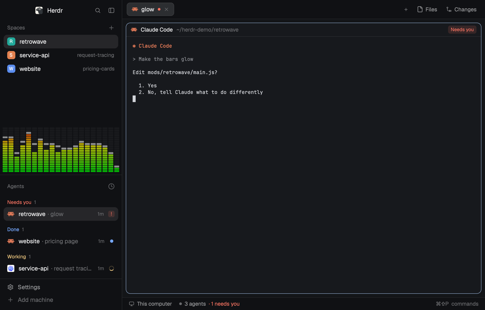

# RetroWave for Herdr

A [Herdr](https://herdr.dev) mod that shows
[RetroWave](https://craigday.github.io/homebrew-retrowave/), the LED
spectrum analyzer for macOS, live inside your Herdr window: as a block in a
layout or as a floating window.



## Requirements

- Herdr 0.1.15 or later, with `herdr-app` on your PATH.
- RetroWave 0.1.6 or later: `brew install --cask craigday/retrowave/retrowave`
  (see the [install notes](https://github.com/craigday/homebrew-retrowave#install)
  if Homebrew asks you to trust the tap).
- In RetroWave's menu, turn on **Herdr ▸ Send Frames to Herdr**. RetroWave
  then serves frames on `127.0.0.1:47613`, reachable only from this Mac.

## Install

Ask your agent to add `https://github.com/craigday/retrowave-herdr`, or do
it yourself. This clones the repo to a temporary folder, copies the mod into
your Herdr home, and checks it:

```sh
git clone --depth 1 https://github.com/craigday/retrowave-herdr /tmp/retrowave-herdr
mkdir -p ~/.config/herdr-app/mods
cp -R /tmp/retrowave-herdr/mods/retrowave ~/.config/herdr-app/mods/
herdr-app check ~/.config/herdr-app/mods/retrowave
rm -rf /tmp/retrowave-herdr
```

`check passed` means Herdr can load it. Herdr picks up the new folder while
it runs; no restart needed.

## Use it as a floating window

```sh
herdr-app do mod.open '{"name":"retrowave"}'
```

A 360 × 150 window opens over Herdr and reopens with it. Drag it to move it,
left-click for RetroWave's next colour mode, right-click to close it.

## Lock it into the sidebar

Herdr's own layouts are read-only and replaced on every start, so put the
block in a copy of the layout you use. These steps use `main`, Herdr's
default layout.

1. Clone the layout. This also switches Herdr to the clone:

   ```sh
   herdr-app do layout.clone '{"name":"main","as":"mine"}'
   ```

2. Open `~/.config/herdr-app/layouts/mine.json`. Find the `sidebar` column
   and its `children` list, which holds the `brand`, `sidebar-lists`, and
   `sidebar-footer` blocks. Insert a RetroWave block between `sidebar-lists`
   and `sidebar-footer`:

   ```json
   {
     "id": "sidebar",
     "type": "column",
     "children": [
       { "id": "brand", "...": "..." },
       { "id": "sidebar-lists", "...": "..." },
       { "id": "retrowave", "type": "block", "size": { "px": 150 }, "content": { "mod": "retrowave" } },
       { "id": "sidebar-footer", "...": "..." }
     ]
   }
   ```

   Only the `retrowave` line is new; leave the existing blocks as they are.
   To sit between the Spaces and Agents lists instead, put the same block
   inside `sidebar-lists` between `spaces` and `agents`.

3. Save. Herdr reloads the layout within a second and the display appears.
   If the file has a mistake, Herdr keeps the old version and writes why to
   `~/.config/herdr-app/layout.error`.

The block is 20 columns of 20 segments and stretches to fill its space, so
pick a height that suits your sidebar width: 150 px looks right at 320 px
wide, 110 px at Herdr's default 268 px. The layout copy is yours and never
updated by Herdr. Ctrl-Shift-L cycles back to the stock layouts, and
`herdr-app do layout.switch '{"name":"mine"}'` returns to this one.

## Check it works

```sh
lsof -nP -iTCP:47613
```

should list `RetroWave` listening and `Herdr` connected to
`127.0.0.1:47613`. Play some audio: the bars move in step with RetroWave,
and RetroWave hides its own window while Herdr shows the display
(**Herdr ▸ Hide Window While Herdr Shows It**, on by default). Left-click
the display for the next colour mode.

If the block reads **RetroWave not running**, check in this order:

- RetroWave is running (its icon is in the menu bar).
- **Herdr ▸ Send Frames to Herdr** is turned on in RetroWave's menu.
- RetroWave is 0.1.6 or later: the version is the first line of its menu.
  `brew upgrade --cask retrowave` updates it.

The mod reconnects by itself every 3 seconds, so once RetroWave is serving,
the display comes back on its own.

To use another port, run `defaults write com.craigday.retrowave herdrPort <port>`,
restart RetroWave, and give the mod the same port as a prop:
`{ "mod": "retrowave", "props": { "port": <port> } }`.

See [RECIPE.md](RECIPE.md) for the protocol, the mod's internals, and its
limits. RetroWave itself is free to use; its source is not published. Bugs in
the mod go to this repo's issues, bugs in RetroWave to the
[RetroWave issues](https://github.com/craigday/homebrew-retrowave/issues).
