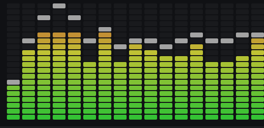

# RetroWave

A live LED spectrum analyzer in your Herdr window. It shows what
[RetroWave](https://github.com/craigday/homebrew-retrowave) is drawing
from your Mac's audio: twenty columns of LED segments with peak hold,
colour modes and beat flash. Put it in a layout as a block, for example in
the sidebar between Spaces and Agents, or open it as a floating window.

## What you see

- A 20 × 20 grid filling the block, with 6px padding all round. Columns
  sit side by side with a 2px gap; within a column, 20 segments are
  stacked with a 1px gap and 1px corner radius. Every column and segment
  shares the space equally, so the grid stretches to any block size.
  110px tall by the sidebar's full width (268px in Herdr's `main` layout)
  looks right.
- Unlit segments are `#ffffff0a`, a faint grid on any background. Lit
  segments take the exact colours RetroWave paints for bars and peaks,
  with brightness and beat flash already applied. Some
  segments are part-transparent (fading peaks).
- While RetroWave is in standby (silence), the whole grid is unlit; its
  standby sweep animation is not sent.
- When RetroWave isn't reachable, the block shows "RetroWave not running"
  centred, 11px, in the theme's `dim` colour.
- The glow RetroWave draws around lit segments in its own window is not
  drawn here.

## How it behaves

- It redraws on every frame RetroWave sends: at most 30 per second (60 if
  RetroWave's Frame Rate is set to 60), and only when something changed.
- Left-click anywhere on the grid: RetroWave moves to its next colour mode.
- Opened with `herdr-app do mod.open '{"name":"retrowave"}'`, it becomes a
  kept window (360 × 150, key `retrowave`) that reopens with Herdr and the
  layout it was opened in. Drag it to move it. Right-click closes it.
- If RetroWave quits or turns its output off, the block shows the
  offline text and reconnects by itself every 3 seconds.
- While at least one Herdr display is connected, RetroWave hides its own
  floating window (a RetroWave setting, on by default) and shows it again
  when the last one disconnects.

## Built from

- One mod, `mods/retrowave/` (`main.js`, `mod.json`). No layout, no
  `keys.json`.
- Requires RetroWave 0.1.6 or later on the same Mac, with **Herdr ▸ Send
  Frames to Herdr** turned on in its menu. RetroWave then listens on
  `127.0.0.1:47613` (loopback only).
- The protocol is newline-delimited JSON over TCP. Each line from
  RetroWave is a whole frame:
  `{"v":1,"cols":20,"rows":20,"tiles":[[col,row,"rrggbb"],[col,row,"rrggbb",0.42],...]}`.
  Rows count from 0 at the top; the optional fourth element is opacity
  below 1. Standby is `{"v":1,"idle":true}`. The only line the mod sends is
  `next-mode\n`.
- `main.js` connects with `net.connect("127.0.0.1", port)` (`import net
  from "net"`), reads with `socket.read(65536)`, keeps only the newest
  complete line of each read, and stores lit segments in a `Map` keyed by
  `col * rows + row`. `render` builds an `h_flex` of 20 `v_flex` columns of
  `div().flex_1()` segments.
- `props`: `port` (default 47613). As a block: `{ "mod": "retrowave" }` or
  `{ "mod": "retrowave", "props": { "port": 47614 } }`.
- `mod.json` is `{"place":"none","overlay":{"kind":"popup","frame":"none","width":1,"height":1}}`:
  `mod.open` starts it as an invisible 1 × 1 popup, which opens the kept
  window with `openOverlay({kind:"window", key:"retrowave", keep:true,
  props:{window:true, port}})` and closes itself.
- Herdr functions: `props`, `theme`, `openOverlay`, `closeOverlay`;
  `cx.spawn`, `cx.timer.after`, `cx.notify`.
- It reaches the network: one TCP connection to 127.0.0.1 only. It runs no
  programs and reads no files.

## Watch out

- `h_flex` centres its children vertically: each column needs `.h_full()`,
  or the columns collapse to nothing.
- Frames arrive faster than a slow render can keep up with. Paint only the
  newest line in each read and drop the rest, or the display lags behind
  the audio.
- Decode frames with `String.fromCharCode` over the bytes in chunks; the
  lines are ASCII.
- `overlay.close` does not close a kept window. The mod's own
  `closeOverlay(props().overlay)` (right-click) does, and so does switching
  to a layout it wasn't opened in.
- Herdr's whole window redraws with each frame: at 30 fps Herdr uses about
  15% more CPU (measured on an M5 Pro).
- Another port means changing both sides: `defaults write
  com.craigday.retrowave herdrPort <port>` and the mod's `port` prop.

## Done when

- `herdr-app check mods/retrowave` passes.
- With RetroWave quit, the block shows "RetroWave not running".
- Start RetroWave with Send Frames to Herdr on and play audio: the bars
  move in step with RetroWave and RetroWave's own window hides.
- `lsof -nP -iTCP:47613` shows a Herdr connection to 127.0.0.1:47613.
- A left-click changes RetroWave's colour mode.
- Stop the audio: after RetroWave's standby delay (30 s by default) the
  grid goes dark.
